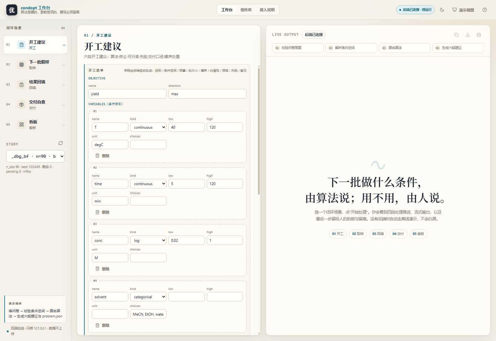
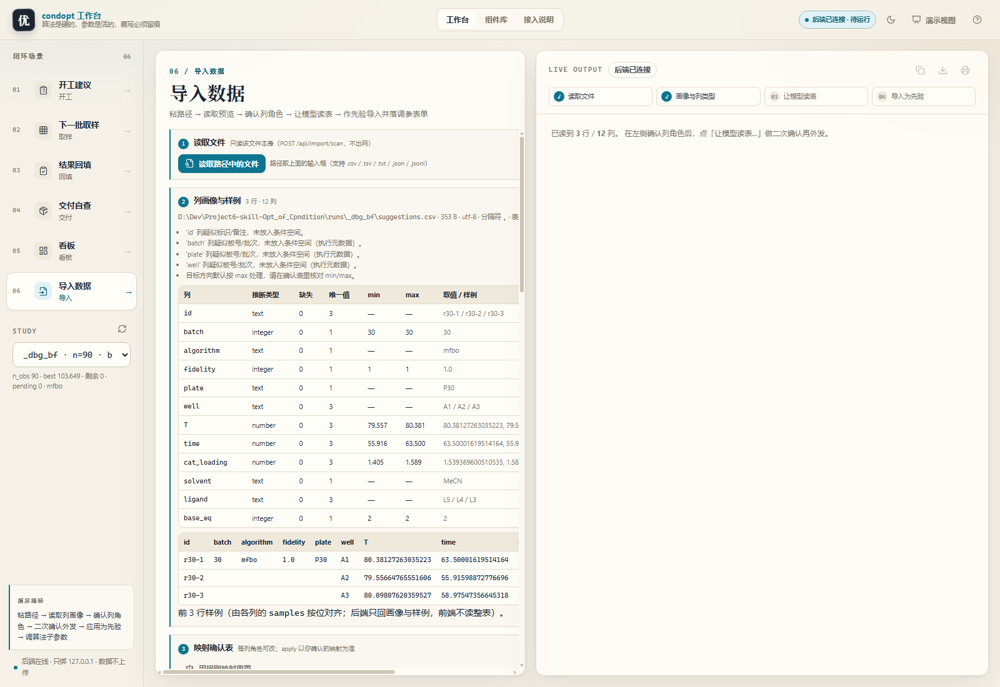

# condopt 工作台

> **本仓是 condopt 的交互面（保留面，2026-11-22 起）。** 优化库本体与 skill 真源在
> <https://github.com/sprw-li/condopt-router>；DSH 面板那条路径已冻结（`dsh-condopt`）。

> 把 [condopt](https://github.com/sprw-li/condopt-router) 包成一个**浏览器里的实验工作台**：
> 开工建议 → 下一批取样 → 结果回填 → 交付自查 → 看板 → 导入已有数据。
> 界面复用本机已有的一个前端复用包（EduKit，无构建、无 npm、断网可跑）；来源见 [`web/ADAPTATION.md`](web/ADAPTATION.md)。

本仓库**独立于** [condopt-router](https://github.com/sprw-li/condopt-router)：优化库本体不在这里，
工作台通过 `import condopt` 使用它（依赖声明见 [`requirements.txt`](requirements.txt)）。
两者只共享一份数据契约——`runs/<study>/` 里的那 6 个文件。

## 依赖：condopt 是外部库

```powershell
# 方式 1（推荐）：装正式依赖
py -3 -m pip install -r requirements.txt

# 方式 2：对着本地源码跑（开发时）
$env:CONDOPT_SRC = '<你的 condopt 检出>\src'

# 方式 3：把 condopt-router 检出放在本仓库同级目录，自动发现（condopt-router / Project6-skill-Opt_of_Cpndition）
```

定位顺序：**已安装的包 → `CONDOPT_SRC` → 同级检出**；三级都找不到时启动即报
「找不到 condopt：请先 pip install -r requirements.txt …」，不会带着半截状态继续跑。

## 60 秒开始



```powershell
# 仓库根目录
start.cmd
```

等价的显式命令：

```powershell
$env:PYTHONUTF8='1'
py -3 server.py --port 8770 --open                      # 默认 --runs-dir state\runs
py -3 server.py --port 8770 --open --runs-dir <某个 condopt 的 runs 目录>
```

浏览器打开 `http://127.0.0.1:8770/`。默认 `state\runs` 是工作台自带的目录（适合从零建新 study）；
想直接看已有实验，把 `--runs-dir` 指到 condopt 那边的 `runs\` 即可。

## 六个场景（一屏一条窄闭环）

| # | 场景 | 干什么 | 背后调用 |
|---|---|---|---|
| 01 | 开工建议 | 按问卷答案给出六段开工建议：算法 / 停止 / 可行率 / 先验 / 交付口径 / 噪声处置 | `prepare` + `registry` 路由 |
| 02 | 下一批取样 | 生成下一批待测条件（含 plate/well/batch），写入 `pending.json` 与 `suggestions.csv` | `Study.ask` |
| 03 | 结果回填 | 把实测结果写回 `dataset.jsonl` / `rounds.json`，校验 id、约束与单位 | `Study.tell` |
| 04 | 交付自查 | 交付清单 + 完整性自检 + 收尾建议 + 可交付摘要 | `Study.delivery_checklist` / `check_integrity` / `recommend` |
| 05 | 看板 | 收敛曲线 / 空间覆盖 / 建议批次 / 决策与覆写理由 / Pareto | `condopt.render.render_study` |
| 06 | 导入数据 | 粘一个文件路径 → 后端读 + 让模型判断「哪列是条件、哪列是目标」→ 人工确认 → 作先验导入 → 落到调参表单 | `Study.import_observations` + 模型读表 |

「人工拍板」区保留上游的复核交互：把 `Study.override(algorithm, reason)` 做成必须写理由的留痕动作，
对应 `decisions.jsonl` 里的一条记录。

## 导入已有数据（场景 06）



已经有历史实验数据时，不用手写 JSON：**粘一个文件路径**就行。

1. **读取** —— 后端在本地读文件（只读），给出列画像（类型/缺失/唯一值/min/max/样例）与前几行；
2. **映射确认** —— 哪几列是条件、哪列是目标、哪些是约束/保真/成本，逐列可改；默认值来自规则推断；
3. **让模型读表**（可选）—— 把「表头 + 列画像 + 前 N 行样本」发给模型，让它处理脏表头 / 自然语言列名，
   返回严格 JSON 的映射建议 + 理由 + 置信度。**发送前必须二次确认**（弹窗列明目标 URL、模型、行数、字节数）；
4. **导入** —— 按确认后的映射转成观测，用 `Study.import_observations` 作**先验**导入：
   计入 `budget`、按 (条件, 保真) 去重、标记暖启动宽限期；坏行逐行给原因，不静默丢；
5. **直接到调参** —— 导入完成立刻渲染该算法的**子参数表单**（`params_schema` 来自 `registry` 的
   `AlgorithmSpec.params`，不是手写文档），调完就能「生成下一批」。

可粘贴的示例（**合成数据，不是真实实验**，见 `examples/README.md`）：

```
examples\history_yield.csv     # 90 行干净宽表
examples\history_messy.csv     # 故意带 n/a、空值、全空列
```

### 模型通道配置（步骤 3 需要）

这是工作台**唯一**会出网的路径，且**默认关闭**。开启需要两个条件同时满足：

```powershell
$env:BOHRIUM_API_KEY = '<你的 key>'        # 默认读这个名字，可用 CONDOPT_IMPORT_LLM_API_KEY_ENV 改
py -3 server.py --import-llm --runs-dir runs
```

| 环境变量 | 默认 | 说明 |
|---|---|---|
| `CONDOPT_IMPORT_LLM_BASE_URL` | `https://open.bohrium.com/openapi/model-gateway/v1` | OpenAI 兼容网关（本机 DSH 已在用同一个） |
| `CONDOPT_IMPORT_LLM_API_KEY_ENV` | `BOHRIUM_API_KEY` | 从哪个环境变量读密钥 |
| `CONDOPT_IMPORT_LLM_MODEL` | `qwen3.8-27b` | 读表用的模型 id |

- 未开开关或没配密钥 → 明确的 `E_LLM_UNAVAILABLE`（不静默降级），可以改走**离线规则映射**。
- 只发**表头 + 列画像 + 前 N 行样本**（默认 12 行，上限 50），**绝不发整文件**；密钥不写盘、不回显、不进日志。
- **同意弹窗上的行数与字节数是真值，不是估算**：`scan` 会先用与 `map` 完全相同的提示词构造路径算出「若现在发送会是多少字节」
  （`sample_preview`），并且这条是**硬不变量**——`scan` 预告的字节数必须**等于** `map` 实际发出的字节数
  （测试里从 stub 网关侧量原始 body 三方比对）。若参数变了没重扫，`map` 会在 `warnings` 里显式说明差异，不静默。
- **配置错不给假安心**：网关地址显式置空、含空白、端口不合法、非 ASCII 主机、误拼 `/chat/completions`……都会让
  `bootstrap.import_llm.url_valid=false` + `import.url_error` 给出人话原因；此时弹窗**事前**预警、**禁用确认按钮**，
  并给「改走离线规则映射」的出路（而不是等用户点了确认才回一个 503）。显式置空**不会**回退到默认外部端点。
- 导入动作会在 `runs\<id>\import_audit.jsonl` 留痕（文件 sha256、来源 llm/rules、模型、consent、接受/拒绝行数、理由）。

## 复用了什么

| 复用 | 来源 | 改动 |
|---|---|---|
| 设计系统 `base.css` / `components.css` | EduKit | 不改语义，品牌变量在 `app.css` 覆盖 |
| 工作台引擎 `app.js`（状态 / SSE / Markdown / KaTeX / 复核 / 留痕） | EduKit | 只加钩子，逐条记在 `web/ADAPTATION.md` |
| 12 个教育场景组件 + 组件库页 | EduKit | 直接复用，见 `web/components/index.html` |
| 离线依赖 `marked` / `DOMPurify` / `KaTeX` / `Lucide` / `canvas-confetti` | EduKit `vendor/` | 原样保留（含 `licenses/`） |
| 场景与话术 `data.js` | 本仓库 | 换成 condopt 五场景 |

上游的三条复用路径（换数据 / 换视觉 / 接后端）里的**第三条**就是本工作台做的事：
只替换 `EduKit.EduAPI.run`，接上 `/api/run` 的 SSE。

## 架构：工作台不引入第二份状态

```
浏览器（web/，复用 EduKit，无构建）
      │  GET /api/*        POST /api/action        POST /api/run (SSE)
      ▼
server.py（stdlib http.server，只绑 127.0.0.1）
      │  进程内调用 Python API（不解析 CLI 文本、不起子进程）
      ▼
src/condopt（唯一写者：Study / prepare / registry / render）
      ▼
runs/<study>/（唯一真源：problem/config/dataset/pending/rounds/decisions/opt_state）
```

- 工作台**不自己维护实验状态**，也不写 runs 目录以外的任何路径。
- 写操作全局串行（一把锁），避免两个浏览器标签同时 `ask`/`tell` 打架。
- 详细端点、请求/响应形状、SSE 帧格式、错误码：见 [`CONTRACT.md`](CONTRACT.md)（冻结的唯一真源）。

## 安全边界

- 只绑 `127.0.0.1`：`--host` 传别的值直接退出。
- 只有 `GET` / `POST`：其余方法一律 405；路径穿越 400；未知路径 404。
- 页面不引 CDN，依赖全部在 `web/vendor/`；**默认不发任何外网请求**。
  唯一例外是 [导入数据](#导入已有数据场景-06) 的第 3 步：显式开 `--import-llm`、显式同意后，
  才把样本行发给模型网关（见 CONTRACT §9.1）。
- 导入的路径受限：默认只能读**仓库根与 runs-dir** 下的 `.csv/.tsv/.txt/.json/.jsonl`，
  大小上限 20 MB，`resolve()` 后必须仍在允许根内（`--allow-import-root` 可加，`--max-import-bytes` 可调）。
- 无鉴权，**不要**把这个服务暴露到局域网或公网。

## 目录

```
start.cmd          一键启动
server.py          stdlib HTTP 服务：静态资源 + JSON API + SSE
bridge.py          condopt 桥接层（进程内调用，可单独测试）+ condopt 依赖定位
CONTRACT.md        接口契约（冻结的唯一真源）
README.md          本文件
VERIFICATION.md    独立验收报告（逐条命令原文 + 输出 + FAIL 复现）
requirements.txt   依赖：condopt（git 地址）+ numpy/scipy/scikit-learn/matplotlib
conftest.py        测试入口（把本仓库根与 condopt 放进 sys.path）
examples/          可直接粘贴的导入示例（合成数据，见其 README）
web/               复用的 EduKit 工作台（index.html / assets/ / vendor/ / components/）
  ADAPTATION.md    对上游文件改了哪、为什么（含 app.js 每一处钩子）
  _shots/          截图证据（只发布文档引用的几张）
_verify/           独立验收的探针脚本（日志/截图/临时 runs 是运行产物，不入库）
tests/             工作台自己的测试（契约 + 导入）
state/             工作台自带的 runs 目录（默认写入位置，不入库）
```

## 验收

```powershell
$env:PYTHONUTF8='1'

# 1) 工作台测试（契约 31 项 + 导入 35 项）
py -3 -m pytest -q

# 2) 服务自检（起服务→自检→退出，不挂住）
py -3 server.py --port 0 --selftest

# 3) 独立验收脚本（需要 requirements-dev.txt 里的 websocket-client；日志落在 _verify/logs/）
py -3 _verify\v03_e2e.py
py -3 _verify\v13_import.py
```

独立验收记录（含 FAIL 复现、修复前后对照、冻结哈希）见 [`VERIFICATION.md`](VERIFICATION.md)。

## 边界与不做

- 工作台是**本机单人工具**：没有登录、没有多用户、没有数据库、没有 WebSocket。
- 不做 PDF/图片解析、不跑模型、不做 RAG —— 上游 EduKit 的 mock 输出只用于演示，页面会标注「离线演示」。
- 不引入前端框架与构建链（这是复用 EduKit 的原因：90 分钟内改得动比体积更重要）。
- 与 condopt-router 自带的静态看板（`scripts/render.py` / `scripts/serve.py`）并存：
  **静态看板是只读产物**（可以单独发给别人），**工作台是可交互的本地闭环**；
  工作台里的「看板」场景直接调用 `condopt.render.render_study`，两者产物一致。
- `web/components/index.html`（组件库页）仍保留上游 EduKit 的教育场景示例与品牌，只保证可打开；
  它是「上游设计系统长什么样」的参考页，未 condopt 化（要改属于新增范围）。

## 已知风险（独立验收记录，未修）

- `GET /api/study` 会真的调用 `Study.next_action()` 与 `Study.recommend()`。目前这两个方法**实测无副作用**
  （连续调用 run 目录文件哈希不变，已有测试断言 `GET /api/*` 零副作用），但「只读端点」的正确性
  因此押在 condopt 内部实现永远保持只读上。若将来 `next_action` / `recommend` 出现任何记账或落盘，
  `GET` 就会静默写 run 目录，违反 CONTRACT §4.2-2。
  缓解：`tests/test_workbench.py` 已有哈希断言会在那时变红；长期方案是在 condopt 侧给这两个方法加只读约束或提供 read-only 变体。
